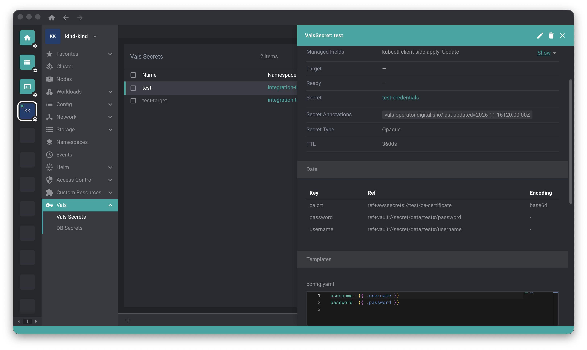
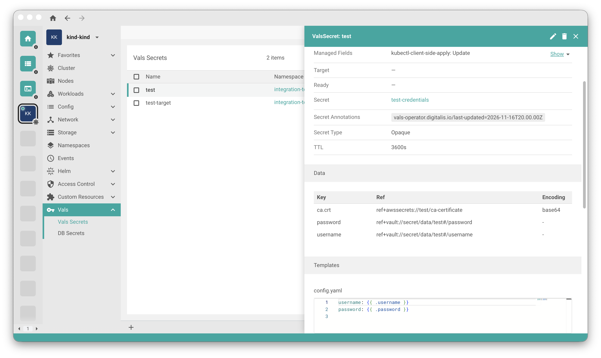

# @freelensapp/vals-extension

[](https://freelens.app)
[](https://github.com/freelensapp/freelens-vals-extension)
<!-- [](https://deepwiki.com/freelensapp/freelens-vals-extension) -->
[](https://github.com/freelensapp/freelens-vals-extension)
[](https://www.npmjs.com/package/@freelensapp/vals-extension)
[](https://github.com/freelensapp/freelens-vals-extension/actions/workflows/integration-tests.yaml)

## Overview

A [Freelens](https://freelens.app) extension for
[vals-operator](https://github.com/digitalis-io/vals-operator), the Kubernetes
operator that syncs secrets from the backends of
[vals](https://github.com/helmfile/vals), such as HashiCorp Vault, AWS Secrets
Manager or GCP Secret Manager, into Kubernetes `Secret`s.

The extension adds a "Vals" entry to the cluster sidebar, with a list page for
each of the operator's resources, and a details panel for each:

- **Vals Secrets**: the `Secret` that a `ValsSecret` writes, and the number
  of its data keys.
  The details show the annotations of the written `Secret` or custom target,
  such as the time of the last update, the `ref` of every data source, the
  templates, the databases whose password the operator updates, the rollout
  targets, the custom target and its last apply, and the conditions.
- **DB Secrets**: the `Secret` that a `DbSecret` writes, the Vault mount and
  role that issue its credentials, and whether the operator renews their
  lease. The details show the annotations of the `Secret`, with its lease and
  expiry, the templates and the rollout targets as well.

The written `Secret` and the rollout targets link to their details in
Freelens. Of the objects that the operator writes, the extension reads the
metadata only: it never reads the data of a `Secret`, and shows the reference
of a secret, never its value.





## Requirements

- Freelens >= 2.0.0
- Kubernetes >= 1.24

## Supported APIs

The resources of [vals-operator](https://github.com/digitalis-io/vals-operator)
v0.12.0:

| API Group      | API Version | Kind         | Scope      |
| -------------- | ----------- | ------------ | ---------- |
| `digitalis.io` | v1          | `ValsSecret` | Namespaced |
| `digitalis.io` | v1beta1     | `DbSecret`   | Namespaced |

To install the Custom Resource Definitions without the operator, for example
on a test cluster, run:

```sh
kubectl apply -k examples/crds
```

Test objects, in the namespace `vals-example`: a `ValsSecret` with data,
templates, a database and a rollout target, a `ValsSecret` with a custom
target, and a `DbSecret`:

```sh
kubectl apply -k examples/test
```

Without the operator they are not reconciled: they write no `Secret` and get
no status.

## Install

Open Freelens and go to Extensions (`ctrl`+`shift`+`E` or
`cmd`+`shift`+`E`). The field at the top takes a package name, the URL of a
tarball, or the path to a tarball or a directory.

### From the registry

Enter `@freelensapp/vals-extension` and press Install.

Alternatively, open the following URL in the browser to install directly:

[freelens://app/extensions/install/%40freelensapp%2Fvals-extension](freelens://app/extensions/install/%40freelensapp%2Fvals-extension)

### From a release tarball

Each [release](https://github.com/freelensapp/freelens-vals-extension/releases)
has the extension as `freelensapp-vals-extension-<version>.tgz`, with its
checksum in `freelensapp-vals-extension-<version>.tgz.sha256`. Use a
release whose major version matches your Freelens version.

- Enter the URL of the `.tgz` asset and press Install. Freelens downloads the
  `.tgz.sha256` next to it and checks the tarball against it.
- Or download both files into one directory and enter the path to the `.tgz`,
  or drop the `.tgz` on the Freelens window. Freelens checks it against the
  `.tgz.sha256` next to it.

### From a directory

Build the extension (see below), then enter the path to your checkout, the
directory with `package.json`, and press Install. Freelens runs the extension
from that directory, from the files in `dist/`, and lists it as unverified.
This is how you work on the extension: see
[Development loop](#development-loop).

## Build from the source

### Prerequisites

Use [NVM](https://github.com/nvm-sh/nvm),
[mise-en-place](https://mise.jdx.dev/), or
[windows-nvm](https://github.com/coreybutler/nvm-windows) to install the
Node.js version in `.nvmrc`.

From the root of this repository:

```sh
nvm install
# or
mise install
# or
winget install CoreyButler.NVMforWindows
nvm install "$(cat .nvmrc)"
nvm use "$(cat .nvmrc)"
```

Install pnpm:

```sh
corepack install
# or
curl -fsSL https://get.pnpm.io/install.sh | sh -
# or
winget install pnpm.pnpm
```

### Build extension

```sh
pnpm install
pnpm build
```

The extension is built into `dist/`. To pack it into a tarball:

```sh
pnpm pack
```

One script to bump the prerelease version, build and pack the extension for
testing:

```sh
pnpm pack:dev
```

The tarball is placed in the current directory. Install it as described in
[From a release tarball](#from-a-release-tarball).

### Development loop

Install the extension from your checkout once, as described in
[From a directory](#from-a-directory), then run:

```sh
pnpm dev
```

It rebuilds the extension whenever a source file changes, and Freelens
reloads the extension after each rebuild, without a restart and without
packing. Stop it with `ctrl`+`C`.

Neither `pnpm build` nor `pnpm dev` type-checks; run `pnpm type:check` for
that. A change to `main` or `renderer` in `package.json` needs Freelens
restarted once.

To check the extension in Freelens with an AI agent, see "Checking the
Extension in Freelens Dev" in [AGENTS.md](AGENTS.md).

### Check the code

```sh
pnpm type:check
pnpm test:unit
pnpm lint:check
pnpm knip:check
```

and, for the formats that Biome does not cover:

```sh
pnpm trunk:check
```

### Integration tests

The integration tests drive Freelens dev, started from a
[freelensapp/freelens](https://github.com/freelensapp/freelens) checkout,
against a [kind](https://kind.sigs.k8s.io/) cluster. In the Freelens checkout:

```sh
pnpm dev
```

Freelens dev lists no cluster until a kubeconfig is added in Preferences >
Kubernetes > Kubeconfig Syncs. Add one with the kind cluster, for example:

```sh
kubectl config view --minify --flatten --context kind-kind > ~/kind-kind.kubeconfig
```

Then, with the kind cluster running, in the extension repository:

```sh
pnpm build
pnpm test:integration
```

The tests install the checkout in place, replacing any other installation of
the extension in Freelens dev. They delete the `valssecrets.digitalis.io` and
`dbsecrets.digitalis.io` CRDs, and with them every `ValsSecret` and
`DbSecret`, so use a kind cluster with nothing worth keeping. Without Freelens dev or the cluster the tests are skipped.

Optional variables:

- `TEST_KIND_CLUSTER_NAME`: the kind cluster, `kind` by default, used
  through the context `kind-<name>`.
- `FREELENS_CDP_URL`: the CDP endpoint of Freelens dev,
  `http://127.0.0.1:9223` by default.
- `FREELENS_MAIN_LOG`: a log of the main process to check for errors, such
  as its `lens.log`. Without it only the renderer's errors are checked.

## License

Copyright (c) 2026 Freelens Authors.

[MIT License](https://opensource.org/licenses/MIT)
